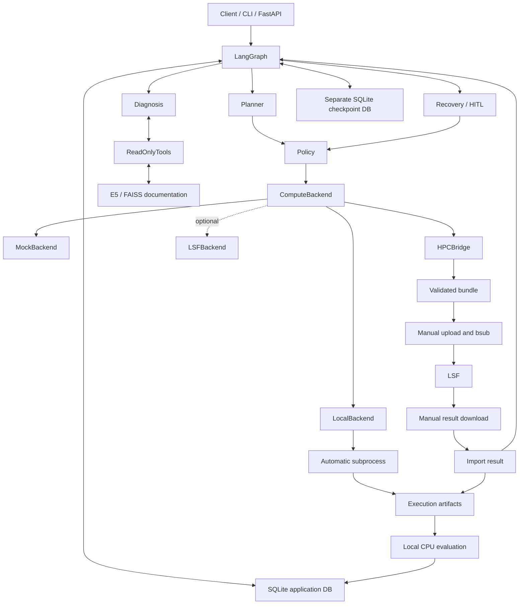
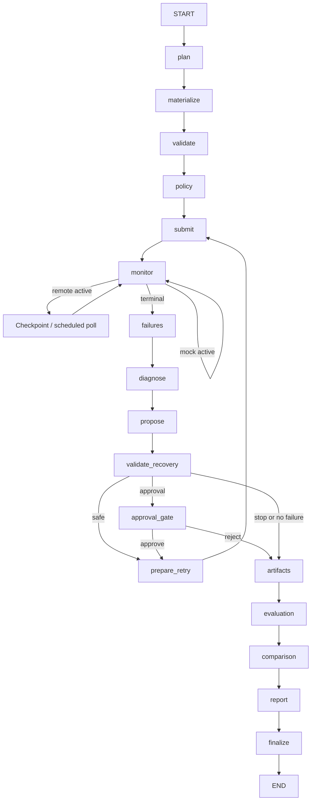
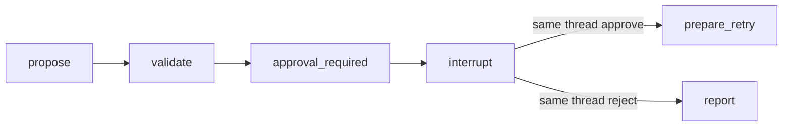

# ML Experiment Agent

A stateful agent for machine-learning experiment planning, controlled execution, failure diagnosis, recovery, evaluation, and HPC-assisted workflows. Python 3.11; local CPU demos need neither an API key nor a cluster.

**Publication notice:** redistribution permission for the bundled school/lab knowledge documents is not yet confirmed. Do not publish this copy until that authorization is resolved.

**Execution modes:** automatic real local processes, deterministic MockBackend for tests/evaluation, and a manual HPC export/import boundary for MFA-protected clusters. LSFBackend remains an optional environment-dependent adapter; no autonomous remote execution or real cluster validation is claimed.

## Motivation and Quick Start

Reliable automation requires execution history, bounded decisions and inspectable evidence. LLMs handle planning, diagnosis reasoning, tool selection and fix proposals. Deterministic code owns config validation, policy decisions, execution authorization, process/job status, retry budgets, metrics and safety boundaries. The system never lets a user goal become an arbitrary shell command.

After cloning your repository, enter `ml_experiment_agent`:

```powershell
py -3.11 -m venv .venv
.venv\Scripts\Activate.ps1
python -m pip install -e ".[dev]"
python -m pytest -q
python scripts/run_local_agent_demo.py
```

Linux: create a Python 3.11 venv and activate it, then use the same Python commands. Install CPU PyTorch first if you want to avoid CUDA packages. Process environment variables are used. The lightweight LSF smoke CLI selectively loads connection settings from ignored `.env`; other commands do not automatically load it.

## Architecture



## LangChain vs LangGraph

LangChain provides ChatDeepSeek, typed tools and structured output. LangGraph owns state, nodes, conditional routing, persistence and interrupts. Numerical comparison and execution authorization never belong to the model.

## Stateful Workflow



Application SQLite is the **source of truth** for Experiment → Run → Attempt, metrics, artifacts, diagnoses and audit events. Graph state stores IDs, routing lists, counters and small report/comparison summaries. Sessions, services, connections, models and full tool conversations never enter state. `thread_id == experiment_id`. The official SQLite checkpointer uses a separate file: a local/small-project choice, replaceable with Postgres for production.

## Tool Calling

DiagnosisAgent exposes exactly five read-only tools: `read_job_log`, `inspect_run`, `retrieve_documentation`, `query_metrics`, `list_artifacts`. Tool output is bounded and audited; the explicit loop permits at most four rounds. No shell, submit, cancel or source-editing tool is exposed.

## Documentation RAG

30 focused Markdown documents cover PyTorch/project troubleshooting and school cluster operations (redistribution authorization pending). Real retrieval uses `intfloat/multilingual-e5-small`, query/passage prefixes and local FAISS with a JSON sidecar, without pickle loading. Retrieval is optional diagnosis evidence, not a general chatbot knowledge base. Supporting IDs must come from actual retrieval.

```powershell
python scripts/ingest_docs.py
python scripts/run_rag_smoke.py
python scripts/run_cluster_rag_smoke.py
```

Default tests use deterministic lightweight embeddings without downloads. Real E5 needs a cached/downloadable model; fake and real runs are explicitly labelled.

## Controlled Recovery

**LLM proposes → Policy decides → Backend executes.** `ConfigPatch` contains only field/value changes. Recovery validates the entire merged RunConfig, ProjectSpec, resources, observed diagnosis, evidence IDs and retry budget. Batch size, accumulation and workers form the operational allowlist. Scientific or sweep changes require approval or stop.

Run identity/original parameters are unchanged. Attempt 1 OOM → proposal 128×1 to 64×2 → policy → Attempt 2 success preserves both attempts. `max_retries=2` means initial attempt plus at most two retries. Submission intent is persisted before external execution; uncertain submissions block instead of risking duplicates. Reports distinguish original design from retry modifications.

## HITL



The interrupt node reads only before `interrupt(payload)`. Resume uses `Command(resume=True/False)` on the same thread. New attempts/jobs are created after approval with durable idempotency guards. The demo uses an epoch change; the CPU toy schema deliberately supports only `float32`.

## Safety Model

- Registered entrypoints, strict schemas, unknown-field rejection.
- Local and remote resolved paths stay under configured roots, including symlink checks.
- Deterministic CPU/GPU/memory/walltime/parallel/retry bounds.
- Exactly three confirmed queues: `734090d!`, `944090d!`, `9654p6000ib!`; no hardware inference.
- OpenSSH argv and fixed remote Python operations receiving JSON through stdin; no `shell=True` or goal interpolation.
- Logs/cancellation restricted to application-owned jobs, with durable ownership records.
- Real LSF disabled by default. No passwords/private keys/API keys in source or audit.

## ComputeBackend / MockBackend

The stable interface is `submit(JobSpec)`, `status(job_id)`, `logs(job_id, tail)`, `cancel(job_id)`. MockBackend deterministically advances QUEUED → RUNNING → terminal, with scenario sequences for retry tests. Successful mock demos explicitly run the real small CPU toy trainer to produce artifacts.

## Local Mode

**Fully automated local execution:** the same LangGraph uses LocalBackend to launch
real `subprocess.Popen` processes from registered JobSpec/ProjectSpec entrypoints.
Exit codes determine success/failure; stdout/stderr stay in each Attempt directory.
No simulated-success step and no post-success training bridge is used in this mode.
The existing evaluation, diagnosis, RAG, recovery and retry nodes remain in place.
Polling uses the existing checkpoint boundary, resumed automatically by the local
CLI; no second graph or process supervisor was added.

```powershell
python scripts/run_local_agent_demo.py
```

This runs a normal CPU training task and a safe resource-failure fixture. The latter
exits nonzero with an explicitly labelled OOM-shaped log at batch size 128, then
retries as a new Attempt at 64×2 and actually trains successfully. It does not cause
real OOM. Diagnosis/proposal/embedding models in these demos are offline fixtures.
Only owned, DB-registered process handles can be cancelled. Active local processes
cannot safely reattach after Agent restart. Local mode currently supports CPU and
zero DataLoader workers; configured resource policy bounds requests but is not an
OS-level CPU/memory sandbox. Polling enforces timeout while the CLI is running.
The existing HTTP API remains unchanged and defaults to MockBackend; use the CLI
for this new real local execution mode.

## HPC Mode

**Agent prepares validated runs → explicit human execution boundary → Agent imports
and continues diagnosis/recovery.** This is an explicit HITL execution boundary: MFA is not bypassed and credentials are never stored. The Agent retains planning, validation, diagnosis, recovery and result analysis; the operator handles validated bundle transport and submission. Upload/download and `bsub` are manual. No SSH
automation is involved. HPCBridge uses the existing ComputeBackend interface only
to export/wait/import, not to perform remote submission.

```powershell
# Specify only a unit actually confirmed for your cluster; never guess it.
python scripts/export_hpc_bundle.py --memory-unit <MB-or-GB>
python scripts/export_hpc_bundle.py --experiment-id <id> --memory-unit <confirmed-unit>
python scripts/import_hpc_result.py data/downloads/<attempt> --memory-unit <confirmed-unit>
# Offline demonstration with explicit fixture resources/results, no cluster:
python scripts/run_hpc_bridge_demo.py
```

Ordinary training exports are blocked without a confirmed memory unit. The current
school unit is still unconfirmed; the fixture demo's MB setting is not a site claim.
CLIs use `data/hpc_execution.sqlite` and a separate checkpoint DB. Each export is:

```text
data/exports/<experiment_id>/<attempt_id>/
  manifest.json    # experiment/run/attempt association, portable config, conventions
  config.yaml      # JSON-compatible YAML, no private home path
  submit.sh        # fixed generation from validated JobSpec + ProjectSpec + policy
  run_bundle.py    # fixed runner, captures stdout/stderr and integer exit.json
  README.txt       # short manual upload/submit/download/import instructions
```

Upload beneath your prepared HPC project root, set `ML_AGENT_PROJECT_ROOT` there,
cd into the bundle and run `bsub < submit.sh`. Project code and dependencies must
already be installed remotely. The bundle contains no credentials or private
connection/root values. The fixed runner blocks duplicate execution of an attempt.
Download the entire directory into the local allowed root before importing.

The internal hpc-<attempt_id> job handle identifies an export, not a real scheduler job ID.
Import validates the manifest against its immutable DB record and checks exit.json,
stdout/stderr, checkpoint, optional metadata and metrics.json. Successful imports
require the registered checkpoint; missing metrics are computed by the existing
local EvaluationService. Supplied metrics pass the existing Pydantic schema.
Repeated identical imports are no-ops; conflicting evidence is rejected. Imported
files/results are trusted operator-supplied evidence, not cryptographic proof of
remote execution. File transfers are bounded to small toy artifacts.

A failed import resumes the same graph's diagnosis/recovery nodes. An approved
operational fix creates Attempt 2 and a new bundle, then pauses for the next manual
submission. Attempt 1 config/logs/diagnosis remain intact. Scientific changes still
use existing approval semantics; the CLI prints pending approval and does not
auto-approve it. Only the log discovery node received a small compatibility fix
so imported stdout/stderr also get the usual combined job.log.

## Optional LSFBackend

Structured submission/status/log/cancel operations and unit/regression tests are implemented. Unattended remote execution depends on the site's authentication environment. The current MFA-protected cluster does **not** have validated automated remote execution. Manual bridge fixtures do not establish real cluster validation. See [optional remote adapter notes](docs/remote_lsf.md).

## Agent Evaluation

```powershell
python scripts/run_evals.py
```

37 offline cases cover planning, validation, diagnosis, retrieval, recovery and safety. JSON/CSV/Markdown exports live under `data/evals/latest/`.

| Metric | Observed offline result |
|---|---:|
| Task success | 35/37 (94.6%) |
| Diagnosis accuracy | 14/14 |
| RAG Hit@3, fixture embeddings | 5/7 |
| Recoverable cases, enabled / disabled | 5/5 / 0/5 |
| Unsafe actions blocked | 9/9 |
| Average Retry Count | 1.0 |
| False Blocking | 0/7 |

Two fixture queue-retrieval failures remain visible. These are small deterministic fixtures, not real-LLM benchmark claims. Real E5 cluster smoke previously retrieved the relevant document first for all three checked queries. Real DeepSeek validation is separate. RAG-on and RAG-off diagnosis accuracy were both 6/6: retrieval adds document evidence, but this fake evaluation does not demonstrate improved diagnosis classification accuracy.

## FastAPI

```powershell
uvicorn ml_experiment_agent.api.app:create_app --factory --host 127.0.0.1 --port 8000 --workers 1
```

| Endpoint | Purpose |
|---|---|
| GET /health | Status/backend, no secrets |
| POST /experiments | goal + registered project_name; HTTP 202 |
| GET /experiments/{id} | Status, runs, attempts, approval payload |
| GET /runs/{id} | Attempt, diagnosis and recovery history |
| GET /experiments/{id}/metrics | Persisted numerical results |
| GET /experiments/{id}/report | Markdown; ready=false while pending |
| POST /experiments/{id}/resume | Strict approved=true/false |

The single in-process worker owns per-invocation sessions. POST returns without waiting for training. Unfinished admitted experiments are inspected on startup. Remote jobs reattach through durable ownership records; lost mock process memory causes reconciliation blocking. Approval requests bind to the exact interrupt and reject duplicates.

Default `ML_AGENT_MODEL_MODE=fake` uses deterministic planning/fixture embeddings. Explicit `deepseek` mode uses ChatDeepSeek and a prepared real FAISS index. `ML_AGENT_BACKEND=lsf` selects environment-configured compute. Requests cannot supply commands, entrypoints or paths.

This is a **single-user local service without authentication**: bind loopback, use exactly one worker, and do not expose it to untrusted networks. No Redis/Celery or distributed workers are included.

## Optional Deployment

A Dockerfile is provided, but image/container runtime has not been verified. Local Python is the recommended starting point. Keep credentials outside images and persist runtime data separately.

## Demo

1. **Mock success:** POST an experiment to the default API; all three fixture rates succeed. `run_phase2_graph_demo.py` additionally demonstrates two successes and one recorded OOM.
2. **Real local success and recovery:** `python scripts/run_local_agent_demo.py`. Real subprocess exit/logs/training; a safe labelled failure fixture triggers the unchanged diagnosis/recovery graph and a new successful Attempt. LLM/RAG are offline fixtures. Existing HITL demos remain `run_phase3b_hitl_demo.py` and `run_phase3b_hitl_demo.py --reject`.
3. **Manual HPC boundary:** `python scripts/run_hpc_bridge_demo.py` proves validated export → imported failure → recovery → next bundle → imported success/report using labelled offline fixtures. Use the export/import CLIs for real operator-managed runs; no real cluster run is claimed.

Also available: `run_phase3a_diagnosis_demo.py --fake`, `print_graph.py`, `test_deepseek_connection.py` (explicit real API).

## Test Results

Latest complete run: **321 passed** (including local execution and manual-HPC integration coverage). Default pytest requires no SSH/LSF/API key/GPU/network/model download. New coverage includes direct/alias SSH, opaque usernames, queue/resource/path safety, scheduler states, ownership, polling checkpoint reload, API lifecycle and HITL.

Phase 2, fake diagnosis, automatic recovery, HITL approve and reject demos ran successfully. FastAPI service implemented and locally verified: Uvicorn actually started and HTTP GET /health returned 200 with the mock backend. The latest LSFBackend check failed noninteractive SSH authentication after passing host-key verification. No real job ID, bjobs sequence, remote logs or artifact were obtained. Docker configuration provided; runtime not locally verified. No real success is inferred from mocks. The new local subprocess success/retry demos and a cross-process HPC CLI export → failed import → new bundle → success import/report round trip were actually executed; the HPC results were explicitly offline fixtures.

## Repository

```text
src/ml_experiment_agent/
  models/ db/ services/    domain, persistence, deterministic capabilities
  backends/               mock, real local processes, optional remote adapter
  graph/                  state, nodes, routing, checkpointing
  agent/ llm/ rag/         diagnosis, proposals, retrieval
  evals/ api/             evaluation, HTTP service and runner
configs/ project_specs/   policy and registered projects
knowledge/               troubleshooting and school manuals
toy_project/ scripts/ tests/
docs/                    remote setup and factual resume notes
data/                    ignored runtime artifacts/databases
```

## Limitations and Production Extensions

Single-instance SQLite is deliberate. No public API auth, distributed transaction, durable external worker or production multi-user isolation is claimed. Ambiguous submit needs operator reconciliation; expired scheduler history is not automatically reconstructed. Remote setup/CLI compatibility still need real-site validation. Toy artifact transfer is capped at 16 MiB; evaluation is local CPU. Concurrent hostile filesystem mutation is outside the single-user threat model.

Add authenticated access, a durable worker and Postgres checkpoints only when required. Those production extensions are not implemented. See [resume notes](docs/resume_notes.md) for evidence-based bullets.
