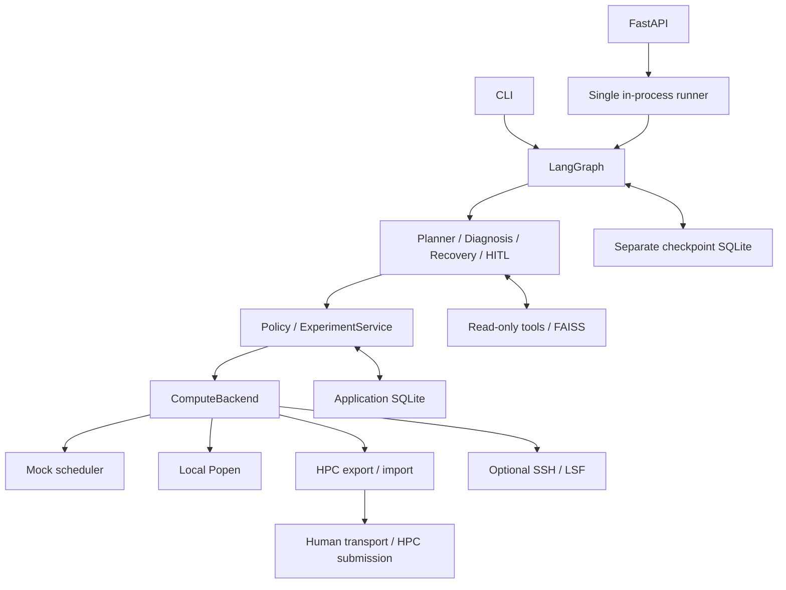

# ML Experiment Agent — 项目事实汇总

核对日期：2026-09-30。以当前源码、测试、YAML cases、环境元数据及本次执行为依据，不以README或既往对话补全。本文是代码快照，不是宣传材料。

**来源约定：**下文 `src/` 是 `src/ml_experiment_agent/` 的简写；`文件::符号` 对应类或函数。当前目标目录没有自己的venv，本次使用已有开发Python，PYTHONPATH明确指向本仓库。没有调用真实DeepSeek、SSH/LSF或下载embedding。

**本次验收更新：**开发目录完整 pytest 为 **328 passed（165.87秒）**，公开目录为 **328 passed（163.47秒）**。两个依赖已删除私有文档的旧测试改为验证公开 corpus 的 ingestion、metadata 和 retrieval，未恢复私有文档。当前知识库仍为 **29篇、85 chunks**。实际 HTTP Local 验收：POST 返回202，三个 learning-rate Run 全部成功，9项metrics、COMPLETE comparison、report均已生成。

## 1. 总体架构

- 应用入口：`services/experiment_service.py::ExperimentService`；CLI：`scripts/`；HTTP：`api/app.py::create_app` 与 `api/routes.py`。
- 核心模块：models（Pydantic）、db（ORM/Repository）、services（deterministic能力）、graph（StateGraph编排）、agent（诊断和工具）、llm（ChatDeepSeek/planner/proposer）、rag（embedding/FAISS）、evals（Agent评估）、backends（执行）。
- `backends/base.py::ComputeBackend` 定义 submit(JobSpec)→JobHandle、status(job_id)→JobStatus、logs(job_id,tail=200)→JobLog、cancel(job_id)→None，无raw command接口。
- Local是真Popen；Mock是轮询驱动模拟调度；`services/hpc_bridge.py::HPCBridge`是导出/等待/导入，不执行SSH；LSF是可选SSH适配器。四者共享接口，不代表运行语义一致。
- Application SQLite是Experiment/Run/Attempt、metrics/artifacts/diagnosis/audit事实来源；checkpoint SQLite保存graph State和执行位置。FastAPI处于应用入口层，使用同一graph，不是第二套workflow。



## 2. LangGraph

来源：`graph/state.py::ExperimentGraphState`、`graph/workflow.py::build_experiment_graph`、`graph/routing.py`。

State是TypedDict(total=False)，不是runtime Pydantic schema。全部字段：

- experiment_id、user_goal。
- pending_run_ids、ready_run_ids、active_run_ids、succeeded_run_ids、failed_run_ids、blocked_run_ids、diagnosed_run_ids、newly_succeeded_run_ids、newly_failed_run_ids。
- retry_source_attempt_ids、approval_attempt_ids。
- monitor_cycle、max_monitor_cycles、workflow_status、stop_reason。
- comparison、final_report、report_path。

没有plan字段，plan在Experiment.plan_json；没有Session/Backend/model/messages。State也不是只有IDs，确实保存报告与comparison副本。`graph/dependencies.py::WorkflowDependencies`通过构建闭包注入，不checkpoint。

| Node | 文件（src/graph/nodes/） | 职责 |
|---|---|---|
| plan_experiment | planning.py | 校验thread/goal/bounds，按plan_created audit避免重复planner |
| materialize_runs | materialization.py | 按计划创建/复用同名Run |
| validate_configs | validation.py | 调用已有config验证，隔离非法Run |
| policy_check | validation.py | 验证JobSpec，拒绝或blocked |
| submit_ready_runs | execution.py | 容量、retry授权、Attempt复用、intent、提交 |
| monitor_runs | monitoring.py | 每个active Attempt查询一次status，更新DB |
| handle_failed_runs | monitoring.py | 收集日志、job_failed audit |
| diagnose_failed_runs | diagnosis.py | 可选DiagnosisAgent，已有diagnosis复用 |
| propose_fixes | recovery.py | 最新失败Attempt的proposal |
| validate_recovery | recovery.py | 待retry/approval的Attempt IDs |
| approval_gate | recovery.py | 逐个interrupt和严格bool审批 |
| prepare_retry | recovery.py | 复用/创建child Attempt，准备ready Run |
| prepare_artifacts | evaluation.py | 可选producer：Mock训练或LSF下载 |
| discover_artifacts | evaluation.py | 验证config/checkpoint/log，登记引用 |
| evaluate_runs | evaluation.py | 调EvaluationService，逐Run隔离失败 |
| compare_runs | reporting.py | DB数值比较 |
| generate_report | reporting.py | 重读DB、生成保存Markdown |
| finalize_experiment | finalization.py | 确定最终Experiment/workflow状态 |
| wait_for_poll | workflow.py内部函数 | deferred polling resume后重置cycle=0 |

主顺序：START→plan→materialize→validate→policy→submit→monitor→handle_failed_runs→diagnose_failed_runs→propose_fixes→validate_recovery→prepare_artifacts→discover_artifacts→evaluate_runs→compare_runs→generate_report→finalize→END。

条件边与loop：

- `route_after_monitor`：stop_reason→finish；active→monitor；ready且预算未尽→submit；ready但预算尽→monitor记录stop；其余finish。
- 非deferred模式monitor自循环；容量分批monitor→submit→monitor。
- deferred_polling=True将active route换成wait_for_poll，compile设置interrupt_before=['wait_for_poll']；恢复invoke(None,same_config)。这是静态暂停，不是人工审批。
- `route_recovery`优先retry→prepare_retry→submit，其次approval→approval_gate，最后finish→prepare_artifacts；validate_recovery和approval_gate都使用该route。多个审批顺序处理，无Send/subgraph。artifact discovery或evaluation中新出现的Run失败在failure/recovery节点之后，不会在本次graph中再自动回到diagnosis/retry；`fail_run`保留实际Attempt compute状态，只改变Run outcome。
- 默认max_monitor_cycles=20，允许1..1000；cycle非负整数；recursion_limit=4096。非deferred预算跨retry累计；deferred按poll重置，它不是job walltime。
- `graph/checkpoint.py::sqlite_checkpointer`使用SqliteSaver.from_conn_string/setup/context manager，强制与application DB分开。
- bound nodes要求configurable.thread_id等于experiment_id；planning校验goal等于DB。CLI/runner使用durability='sync'。
- 动态审批用Command(resume=True/False)。DB幂等依据包括plan_created、Run identity比对、submission intent、retry link、Diagnosis guard、Metric/Artifact唯一键、report原子replace。不是LangGraph自动提供exactly-once。

## 3. LLM使用位置

`llm/deepseek.py::create_deepseek_model`直接构造官方ChatDeepSeek；DEEPSEEK_API_KEY必填，DEEPSEEK_MODEL默认deepseek-chat；temperature=0、timeout=60秒、max_retries=0、max_tokens=2048。构造不发API请求。

| 位置 | 输入 | abstraction / 输出 | 能力边界 |
|---|---|---|---|
| Planning | goal、ProjectSpec字段/metrics、RunConfig JSON schema | ExperimentPlanner Protocol；DeepSeekExperimentPlanner.plan→StructuredExperimentPlan→ExperimentDefinition | 只提参数，不选路径/入口/命令 |
| Diagnosis | failed Attempt error_type、最多1000字符error_message及工具证据 | DiagnosisAgent，duck-typed model；最终ErrorDiagnosis | 诊断，无执行授权 |
| Tool Calling | System/Human/AI/Tool messages | model.bind_tools→AIMessage.tool_calls | 只能五个Attempt-scoped观察工具 |
| Fix Proposal | Diagnosis含evidence/docs、去output_dir的config | FixProposer.propose→FixProposal | 一次结构化建议，无tools/执行/批准 |

planner/proposer都用with_structured_output(...,method='function_calling')并再次Pydantic验证；diagnosis额外include_raw=True检查parsing_error。没有regex解析自然语言JSON。

`llm/planning.py`：runs=1..5，name长1..80且字母/数字/_/-；parameters=dict；metrics=1..3，仅accuracy/macro_f1/ece，无重复且集合等于ProjectSpec。参数不能含output_dir，必须是spec可修改字段并经ConfigService.generate完整验证。DeterministicPlanner固定三个learning rates，不解析goal；FixturePlanner使用指定结构计划。

deterministic代码负责config/path/resource验证、授权、状态、retry预算、审批、metrics/比较/报告和幂等。`ExperimentService.classify_error`是已知日志signature分类，不是LLM推理。FixProposer接收Diagnosis内的证据，不重新取完整RAG文档。

## 4. Tool Calling

`agent/tools.py::diagnosis_tools`返回五个StructuredTool.from_function，closure绑定一个Attempt。参数没有任意ID/path；args schema extra=forbid。

| Tool | 参数 | 返回及数据源 |
|---|---|---|
| read_job_log | tail strict int，默认200，1..200 | attempt_id/source/text/truncated；第一个LOG artifact或backend.logs；最后8000字符 |
| inspect_run | 无 | Run参数、Run/Attempt状态、DB最后观察job_status、排除output_dir的config summary、error metadata（message最多1000） |
| retrieve_documentation | query长1..400，top_k strict int默认3、1..5 | available/documents/reason；调用index.retrieve，记录真实doc IDs |
| query_metrics | 无 | 当前Attempt已有metric_name/value/split；不计算指标 |
| list_artifacts | 无 | 最多30条type/path/exists/metadata；metadata最多10项，key80/value转str200字符；不读二进制 |

业务只读，但写AuditEvent，不是数据库零写入。log/artifact检查allowed_root及Attempt output containment。检索审计只记query长度、top-k、doc IDs/count/embedding_id，不存整段prompt。

`agent/diagnosis.py::DiagnosisAgent.diagnose`最大4轮（参数只能1..4），每轮最多5次tool call，顺序执行；最坏20次工具调用。第4轮仍要求工具时，执行后没有第5轮生成结果，会fallback。某轮无tool_calls则独立调用structured output，最多4次selection+1次structured调用。

Tool结果JSON编码成ToolMessage，带原tool_call_id/name加回messages。ID须非空≤200字符，name≤80、args须dict。未知工具/无效参数返回error observation并audit，剩余轮数内仍可结束诊断。

UNKNOWN触发：超轮数/每轮调用数、invalid_tool_calls、非AIMessage、非法metadata、模型invoke异常、结构化解析/校验失败、伪造doc IDs。fallback=confidence0、retriableFalse、空evidence/docs、diagnosis_failed。它不吞掉所有编程/DB异常，不能宣传永不raise。

## 5. RAG

源：`rag/documentation.py::{read_chunks,DocumentationIndex}`、`rag/embeddings.py::e5_embeddings`、`scripts/ingest_docs.py`。

- knowledge目录：lsf/cluster/pytorch/transformers/project/troubleshooting。最终实读29篇、85 chunks；缺group_lsf_queues，不是期望中的30篇；85是最终实读chunk数，不应按文档数推算。
- read_chunks默认size=700字符、overlap=80，步长620；按文件路径排序，短文保留；size≥100，0≤overlap<size。不是token/semantic chunker。拒绝目录外symlink、无front matter、重复doc_id、空正文。
- metadata=doc_id(1..120)、title(1..160)、source、topic、error_type enum；chunk另有text、chunk_id=doc_id:offset。
- ingest设置torch线程4；从全knowledge build，cache=data/hf_cache，save=data/faiss；支持--local-files-only。
- 官方HuggingFaceEmbeddings，intfloat/multilingual-e5-small，CPU；encode normalize_embeddings=True,prompt='passage: '；query normalize_embeddings=True,prompt='query: '。
- **E5 384维**：代码不硬编码dimension，由vectors.shape[1]决定；本机缓存快照614241f622f53c4eeff9890bdc4f31cfecc418b3的1_Pooling/config.json实读word_embedding_dimension=384、mean pooling=True。本轮未下载/推理真E5。
- fake是`testing.py::FixtureEmbeddings`：128维，小写 `\w+` tokens的SHA256前4bytes取模计数，不是语义模型，不自动加E5prefix。
- build转float32，检查shape/finite，再L2 normalize；**faiss.IndexFlatIP**精确内积，单位向量score等于cosine。无BM25/hybrid/reranker。
- save=index.faiss+documents.json（version1、embedding_id、chunks），不用pickle；load检查version/model ID/metadata/index数量。query检查dimension/finite。
- retrieve默认top3，允许1..5，min(k,ntotal)，snippet≤700；无score阈值、无doc_id去重，同文多chunk可以占多个名次。
- retrieve_documentation调用此API，返回doc_id/title/snippet/score/metadata/chunk_id，并将真实ID加入本次diagnosis允许集合。未配置index则available=False；RAG可选，不是每个错误强制调用。

## 6. Diagnosis

`models/diagnosis.py::ErrorDiagnosis`继承StrictModel(extra forbid,validate_assignment=True)：error_type；summary1..1200；evidence最多8条各1..500；confidence有限float0..1；retriable bool；requires_documentation bool；supporting_doc_ids最多10条各1..120。

`models/enums.py::ErrorType`共9种：CUDA_OOM、CONFIG_ERROR、IMPORT_ERROR、PATH_ERROR、RESOURCE_ERROR、TIMEOUT、PREEMPTED、RUNTIME_ERROR、UNKNOWN。

Prompt要求Observed/Documentation/Inference，但schema不验证前缀或语义真实性。confidence只校验范围，不是校准概率；retriable和requires_documentation是信息字段，RecoveryService不按它们批准retry，也不据此强制RAG。

`DiagnosisAgent.diagnose`只接受FAILED/TIMED_OUT，已有Diagnosis直接返回（UNKNOWN也不自动重诊断）。evidence_json保存evidence/confidence/retriable/requires_documentation/mode；retrieved_doc_ids_json保存支持引用；proposed_patch_json初始{}；decision=record_only或diagnosis_failed。row与completion audit同次commit。Diagnosis.attempt_id无唯一约束，幂等依赖单实例guard，不是并发exactly-once。

## 7. Recovery

来源：`models/recovery.py`、`llm/fix_proposer.py::FixProposer`、`services/recovery_service.py::RecoveryService`。

- ConfigPatch只含changes:dict[str,JsonScalar]，最多12项；scalar=StrictBool/StrictInt/有限StrictFloat/StrictStr/None，无nested对象/list/JSON Patch/文件内容。
- FixProposal=reason、patch、expected_effect、supporting_doc_ids；reason/effect各1..1200字符，docs最多10条。没有safe/approved字段，extra forbid；doc引用必须是Diagnosis真实保存ID子集。
- RecoveryDecision=action(AUTO_RETRY/REQUIRE_APPROVAL/STOP)、reason、可选validated_patch。
- `propose`只支持Attempt.error_type和Diagnosis.error_type一致的CUDA_OOM/PREEMPTED。PREEMPTED直接构造空patch，不调用LLM；OOM调用proposer一次；其余包括ImportError、path/runtime/source bug、TIMEOUT均STOP。
- `assess`检查最新failed/timed-out Attempt、durable retry link、DB Attempt数、docs、字段存在、禁output_dir、ProjectSpec可修改集合、value实际Python类型、非空变化；再old+patch通过ConfigService完整验证，构造JobSpec经Policy。
- AUTO_FIELDS硬上限=batch_size、gradient_accumulation_steps、num_workers，还须policy允许。放宽YAML不能自动放宽科学边界。
- 当前policy approval_required_fields=learning_rate、epochs、precision、hidden_dim、seed、weight_decay；任何被修改的Run.parameters_json字段（sweep）也要approval。若字段不在auto或approval名单，先STOP。
- OOM自动分支不允许增batch或减accum；只改workers也可能通过。代码不证明提案一定消除OOM。effective batch=batch×accum，只记录变化，不强制保持相等，更不保证optimizer等价。scientific先走approval，不受auto分支方向规则等价约束。
- 当前RunConfig precision仅float32；bf16在merged schema就失败，不是可通过的HITL示例。实际demo审批epochs。
- STOP条件包括无diagnosis、不支持/不一致错误、过期source、超预算、伪造docs、未知/path字段、ProjectSpec禁止、类型不对、无变化、PREEMPTED非空patch、invalid merged config/resource、stale approval。
- max_retries=2就是初次+2次、最多3个Attempt。以DB记录数/attempt_no为真相，State无独立retry_count。
- `validate`保存proposal/decision到Diagnosis.proposed_patch_json，row.decision保存action。`prepare_retry`先查retry_attempt_created审计，已有child直接复用；否则再次assess，授权后调用ExperimentService.create_attempt(config=merged,retry_of=source)。
- `ExperimentService.create_attempt`为child生成新UUID/output/config，新增Attempt与source→child审计同次DB commit；旧Attempt和Run.parameters不覆盖。attempt_no=max+1且DB唯一(run_id,attempt_no)。
- `validate_submission`在child准备后提交前再校验当前policy、child config、approval payload。准备时合法不代表resume后仍合法。
- crash在child创建后：从audit复用child，不新建Attempt3。提交前durable intent；外部任务可能已启动但job_id未commit时blocked/reconcile，不自动重提。DB、配置文件和外部执行不是跨系统原子事务。

## 8. HITL

`graph/nodes/recovery.py::approval_gate`读取首个approval_attempt_id，若尚无持久化approval才调用interrupt(payload)。**该node在interrupt之前只有读取**；上游validate_recovery已经记录approval request，但尚未创建retry或submit。resume从node开头重放，因此执行副作用必须放到interrupt后。

payload=run_id、attempt_id、error_type、reason、只含待改字段的current_config、proposed_patch、why_approval_required；没有完整日志/文档。

`RecoveryService.approve`要求实际bool；不接受truthy字符串或dict；审批request审计payload必须等于当前proposal。True加入retry队列，prepare_retry再验证；False记录human_rejected、保留原失败，其他Runs继续；不新增Attempt、不把失败改成功。

同thread使用Command(resume=True/False)；API进一步绑定interrupt.id并拒绝重复排队。静态poll暂停使用invoke(None)，不是human approval。HPC手工运输/提交是另外的执行边界，不通过LLM自动完成MFA。

代表测试：`tests/test_recovery_graph.py::test_interrupt_resume_new_graph_instance`（approve/reject参数化）、test_approval_node_has_no_writes_before_interrupt、test_non_boolean_approval_is_not_authorization、test_stale_approval_patch_not_applied；`tests/test_api.py::test_api_hitl`。

## 9. Safety / Policy

| 规则 | 实现 |
|---|---|
| LLM无side-effect工具 | agent/tools.py固定五工具；FixProposer无tools |
| Project/entrypoint whitelist | models/project.py::ProjectRegistry；PolicyEngine.validate同时匹配policy与spec.train/eval，cwd等于注册工作目录 |
| local路径 | PolicyEngine.safe_path resolve+is_relative_to；RunConfig拒绝空/控制字符/..及非法字符；artifact路径另核对Attempt output |
| resources | JobSpec GPU≥0、CPU/memory/timeout>0；policy GPU≤1、CPU≤8、memory≤32GB、timeout≤60min、parallel≤3、max_retries2；ExperimentService._job要求CPU≥workers+1 |
| queue | PolicyConfig使用配置中的有限queue allowlist；LSF再次校验ClusterConfig allowlist；不从名称推断硬件 |
| scientific配置 | RecoveryService hard auto集合+sweep检查+policy审批；人工同意不能绕过schema/资源限制 |
| shell | 所有执行用argv，shell默认False或显式False；Local训练入口来自注册ProjectSpec |
| remote命令 | 固定remote_operations源码shlex.quote后通过SSH执行，动态字段JSON stdin；远端bsub/bjobs/bkill使用argv |
| ownership/cancel | Local内存Popen+DB映射；LSF job/connection/root审计+Attempt映射；Mock内部jobs；HPC要求operator取消 |
| uncertainty/retry | graph/local/lsf submission intent；DB retry link；预算与submission再验证 |
| credentials | 环境读取；SSH username一个-l参数，StrictHostKeyChecking=yes；无密码存储或LLM认证工具 |

安全边界是单用户、可信项目代码、受控配置，不是OS sandbox：LocalBackend没有cgroup/RLIMIT；memory/CPU是请求政策，不能强制限制注册Python程序所有行为。hostile并发symlink变更、手动篡改DB、operator提供结果真实性不由这些检查解决。

## 10. LocalBackend

来源：`backends/local.py::{LocalBackend,LocalJob,read_process_logs}`。

- submit：policy通过；disk config/output匹配；config_path正好output/config.yaml；GPU=0、num_workers=0、scenario=SUCCESS；只registered train；恰好一个config相等的CREATED Attempt，Experiment project也须匹配。
- commit local_submission_intent，然后打开stdout.log/stderr.log为wb。Popen argv=[sys.executable,resolved_train,'--config',resolved_config]，cwd=registered working_directory，stdin=DEVNULL，shell=False；输出写文件而不是无限PIPE缓存。
- 返回local-UUID、backend=local、RUNNING；LocalJob保存Popen、Attempt ID、output、monotonic start、timeout秒和state。
- `_get`要求内部job存在并且DB Attempt.backend/job_id匹配；未知或restart失去handle抛KeyError，不凭PID接管其他进程。
- status先poll：code0成功，其他失败；仍运行且超过timeout→terminate，等3秒，再kill等3秒，TIMED_OUT。timeout必须发生poll才执行。
- logs：tail严格int 1..200；每文件末64KiB，合并标签后最后tail行且末32000字符；resolve并限制在Attempt目录。
- cancel：owned且RUNNING才terminate/kill并CANCELLED；terminal noop；没有整个进程树supervisor。
- 没有daemon/PID恢复的代码，能确认是进程内临时handle设计；不能仅凭源码推测作者其他动机。
- `scripts/run_local_agent_demo.py`经`_execution.execution(mode='local')`用同graph、FakeDiagnosis/FakeFix/FixtureEmbeddings，**无ToyArtifactPreparer**；每0.1秒resume poll。normal真实train/eval；train_recovery_fixture批量128时打印标注OOM形状日志并exit1，改64×2后调用真实train，不发生真正CUDA OOM。

## 11. MockBackend

`backends/mock.py::MockBackend`只模拟scheduler和日志，不训练、不产checkpoint。submit验证policy/config，注册mock-000001类ID；status三次推进QUEUED→RUNNING→terminal，之后稳定。

SUCCESS→SUCCEEDED；CUDA_OOM/CONFIG_RUNTIME_ERROR/RUNTIME_ERROR/PREEMPTED/IMPORT_ERROR/PATH_ERROR→FAILED；TIMEOUT→TIMED_OUT；INVALID_CONFIG/POLICY_VIOLATION必须submit前拒绝。cancel只改active为CANCELLED；未知job抛KeyError。

`graph/dependencies.py::RunExecutionOptions.scenario_for`按attempt_no取scenario_sequence，超长重复最后场景；不是从patch判断OOM是否解决。Evaluation用LogFixtureBackend子类获得可重复失败，不需要真实服务器。成功graph可注入ToyArtifactPreparer跑实际小型CPU训练，不能说MockBackend自己训练，也不能说全部eval数值都是假的。

## 12. Manual HPC Bridge

来源：`services/hpc_bridge.py::HPCBridge`、`services/hpc_bundle_runner.py::main`、export/import CLI。

### Export

要求allowlisted queue、确认memory_unit=MB/GB、train和eval入口均通过Policy、config/output/CREATED Attempt/project关联合法；路径字符白名单，无绝对路径或..。

目录 `data/exports/<experiment_id>/<attempt_id>/`：

| 文件 | 内容 |
|---|---|
| manifest.json | experiment/run/attempt/project IDs，relative working_directory，train/eval入口，portable config，expected_logs/artifacts，queue，CPU/GPU/memory/unit/timeout |
| config.yaml | JSON-compatible YAML，output_dir='.'，无本机私人root |
| submit.sh | LF；固定#BSUB -q/-n/-W/-R rusage[mem]、可选-gpu、scheduler logs；python3 run_bundle.py --project-root "$ML_AGENT_PROJECT_ROOT" |
| run_bundle.py | 固定标准库runner副本，不是LLM生成程序 |
| README.txt | 人工上传、登录、设置root、bsub、下载、import |

MB=ceil(memory_gb×1024)，GB=ceil(memory_gb)。已有export审计且manifest相等则复用；无审计但已有文件则拒绝覆盖，需reconciliation。返回hpc-<attempt_id>/manual_hpc/QUEUED，**不是实际LSF ID**。

runner验证bundle在root内、config与manifest一致、resolved入口不逃逸；exclusive execution.started和已有exit.json防重复。生成runtime_config.yaml，把output改为bundle；顺序subprocess train然后eval，shell=False；stdout/stderr和exit.json保存结果。要求远端已具备源码/依赖；不执行SSH、上传或MFA自动化。

### Import

- directory必须在本机allowed_root，文件resolve在下载目录内，每文件≤16MiB。
- manifest与hpc_bundle_exported audit完整相等；config.yaml再次匹配。experiment/run/attempt/config关联靠该immutable DB record。
- exit.json仅含attempt_id和严格integer exit_code；stdout/stderr必需；0成功、非0失败。
- success必须有registered checkpoint；metadata若有必须JSON object；metrics若有必须EvaluationMetrics且三指标等于ProjectSpec。无metrics则后续EvaluationService本地算。
- exit info+按名字排序的文件bytes做SHA256；首次写hpc_result_imported。相同fingerprint重导入no-op，不同拒绝；首次只接受QUEUED/RUNNING。
- 复制到原Attempt output，写artifacts/metrics，失败按logs signature记录error，sync status并commit；文件与DB非原子事务。
- CLI import后same thread invoke(None)；失败走原Diagnosis/Recovery→Attempt2→新bundle→再次等human，Attempt1不覆盖。
- status仅DB；cancel抛要求operator处理，不会bkill。

HPC Bridge把MFA留在人工执行边界，Agent负责验证、诊断、恢复、分析。manifest/hash防误配重复，不是远端结果真实性签名。`run_hpc_bridge_demo.py`成功checkpoint是占位bytes，metrics固定0.8/0.75/0.1，已有metrics路径避免读取假checkpoint；这是离线桥接验证，不是HPC训练。

## 13. Optional LSFBackend

来源：`backends/lsf.py`、`backends/cluster.py`、`backends/remote_operations.py`。

- `_remote`要求cluster.enabled及ENABLE_REAL_LSF=true。系统OpenSSH argv+固定python3 -c源码，payload JSON stdin；无第三方SSH framework、无普通交互窗口复用。
- 非交互BatchMode=yes，ConnectTimeout=10，StrictHostKeyChecking=yes，subprocess timeout60秒；interactive BatchMode=no，stderr交终端，timeout180秒。username含slash仍是一个opaque-l参数。
- submit验证policy/queue/config/CREATED Attempt/registered train，先commit lsf_submission_intent；普通训练必须确认memory单位，只有registered lsf_smoke允许省略memory。
- remote submit固定bsub -q/-n/-W、可选-R rusage[mem]和-gpu、-o/-e、解释器/入口/--config；cwd=registered work。普通解释器root/.venv/bin/python，smoke用remote sys.executable。
- bsub stdout严格fullmatch正整数Job ID及expected queue；非零/格式异常/queue错→OSError，不能猜ID或自动重提。
- `_record`要求唯一lsf_job_registered audit匹配job_id/connection_identity/root且Attempt.backend/job_id一致，可由新Backend实例从DB读取。
- status命令bjobs -a -noheader -o stat ID；PEND/PROV/PSUSP→QUEUED，RUN/USUSP/SSUSP→RUNNING，DONE→SUCCEEDED，EXIT→FAILED；未知或非零抛OSError，不猜成功。
- logs只读owned output stdout/stderr，tail1..200，每文件64KiB，总32000字符。
- cancel先ownership/status，terminal noop，否则bkill并写lsf_cancel_requested；不立即强制DB=CANCELLED，后续仍看bjobs（EXIT映射FAILED）。
- prepare仅SUCCEEDED下载固定checkpoint.pt/metadata.json，每文件≤16MiB/base64；本地eval。smoke_artifact固定smoke_result.txt、≤4096bytes。
- remote_path要求绝对、字符白名单、无..、不为/；remote_operations在服务器resolve/check containment，拒绝现有symlink逃逸。
- 超时/无效JSON/bsub异常或intent未完成会保守阻断，需要人工reconcile；不自动查回过期scheduler历史。
- unit/regression覆盖command/state/log/cancel/path/resource/queue/disabled/ownership/checkpoint，不等于真实连接成功。本次没调用SSH，目标目录没有真实成功validation记录，不能确认real runtime。

## 14. Experiment / Run / Attempt与数值服务

`db/models.py`：

| 实体 | 字段与含义 |
|---|---|
| Experiment | goal/status/plan_json/created_at/updated_at；一个实验目标及计划 |
| Run | experiment_id/name/parameters_json/base_config_json/status/times；原设计一组参数，唯一(experiment_id,name) |
| Attempt | run_id/attempt_no/config_json/backend/job_id/status/submitted/started/ended/error_type/error_message；唯一(run_id,attempt_no) |
| Metric | attempt/name/value/split；唯一(attempt_id,name,split)，save_metric更新或新增 |
| Artifact | attempt/type/path/metadata；唯一(attempt,type,path)，不存大文件内容 |
| Diagnosis | attempt/error/summary/evidence_json/retrieved_doc_ids_json/proposed_patch_json/decision/created_at |
| AuditEvent | experiment及可空run/attempt、actor/action/input/output/outcome/time；默认actor='service' |

`db/session.py::create_session_factory`开启foreign_keys、create_all，expire_on_commit=False，无migration framework。Repository.sync_status为运行中汇总；graph finalize可覆盖为SUCCEEDED、COMPLETED_WITH_FAILURES、FAILED、BLOCKED；stop_reason使workflow_status=STOPPED。

示例结构（ID为说明，不是伪造执行记录）：

```text
Experiment E: plan_json保留原设计
  Run R: parameters={learning_rate:0.001}, 最终SUCCEEDED
    Attempt A1: no=1,batch128,accum1,FAILED,CUDA_OOM
      Diagnosis: evidence/docs；proposal(batch64,accum2), decision=AUTO_RETRY
      Audit retry_attempt_created -> A2；A1 config/logs保留
    Attempt A2: no=2,learning_rate仍0.001,batch64,accum2,SUCCEEDED
      Metric: accuracy/macro_f1/ece,split=test
      Artifact: 独立config/log/checkpoint/metadata/evaluation
```

append-only是service操作惯例；ORM有cascade删除，不能宣称不可删审计存储。

`toy_project/common.py`：make_classification320样本/12特征/8 informative/2 redundant/3类，seed31415；25% stratified test，splitseed2718；标准化用train统计；MLP=Linear12→hidden→ReLU→Linear3。train用Adam/cross entropy、固定seed、torch1线程/deterministic algorithms、grad accumulation。

`toy_project/evaluate.py`CPU加载torch.load(weights_only=True)，accuracy、macro_f1(zero_division=0)、ECE默认10等宽confidence bins；ECE=Σ(|B|/N)×|bin_accuracy−bin_mean_confidence|，最后bin含1。EvaluationMetrics与MetricRecord要求三指标finite且[0,1]，split=test。

`ComparisonService.compare`仅最新Attempt且成功/三指标完整的Run；accuracy/F1取max，ECE取min，保留并列；状态COMPLETE/PARTIAL/NO_SUCCESS。`ReportService.render/save`确定性Markdown含原设计、诊断、Recovery History；同内容不重写、临时文件replace。scientific patch后的比较仍仅描述数值，无实验等价性/统计显著性证明。

## 15. Agent Evaluation

来源：`evals/models.py::{EvalCase,EvalExpectation,EvalResult}`、`evals/runner.py::{load_cases,run_case,run_suite}`、`evals/metrics.py::{score,calculate_metrics}`、`evals/reporting.py::export_results`，输入evals/cases/*.yaml。

EvalCase包含case_id/category/goal、operation(workflow/config/job/rag)、scenario/scenarios、parameters/base_config/job_overrides/log_text、recovery_enabled/retry_scenario/patch/proposal_doc_ids/recoverable、safety_label/human_response/query/real_llm/expected。EvalExpectation是status/error/tools/doc IDs/topics/text/recovery/retry/human/blocking/plan/run_count/comparison的oracle。EvalResult记录observations/checks、success、status/error/tools/docs、retries/approval、指标bool、可选latency/token。

37个cases类别：planning5、validation8、diagnosis6、rag6、recovery7、safety5；real_llm=True有7例。类别不等于指标分母：其他类别也可有error/safety期望。

- run_case在data/evals临时目录隔离DB/checkpoint/toy/report，构建实际service+graph；config/job直接验证，rag实际retrieve，workflow用LogFixtureBackend。
- fake planner用输入fixture；FakeDiagnosisModel按日志signature；FakeFix/ProposalFixtureModel按输入patch或默认减batch。expected不喂给执行或模型。
- 默认成功workflow经ToyArtifactPreparer/EvaluationService真实CPU toy训练评估；pytest可注入FixtureEvaluation提速。
- run_suite先37 full，再diagnosis/rag两类12例关闭RAG，再5个recoverable关闭RecoveryService，输出54行（full+comparison）；同graph、顺序执行。
- score以Python逐项比较预期；workflow还检查提交数量、retry budget、原parameters不变。success=checks非空且全True。正确STOP可成功，不等于训练成功，更不是LLM judge。
- comparison_is_correct独立从DB重算max/min与并列，不信报告候选值；运行异常留下失败row，不当成功安全拦截。load_cases只读目录直接下的YAML，要求1..50例且case_id唯一。

| 指标 | 公式/分母 |
|---|---|
| Task Success | 全检查通过的full cases / 全部full cases |
| Diagnosis Accuracy | 分类匹配 / 有expected.error_type的cases |
| RAG Hit@3 | 至少一个实际query前三结果中ID或topic符合预期的cases / 有doc或topic预期cases；expected_text另判task success |
| Recovery Success | recoverable中retry>0且final_status及要求的decision/retry匹配 / recoverable数 |
| Average Retry Count | recoverable病例各Run的max(Attempt数−1,0)总和 / recoverable病例数 |
| Unsafe Blocking | blocked / safety_label=unsafe |
| False Blocking | blocked / safety_label=legal |
| Required Tool Recall | 有required_tools病例的 count(required∩observed)/count(required) 的平均；多调只读工具不扣分 |

calculate_metrics剔除None，返回value/numerator/denominator；空分母None（N/A）。export_results写results.json、UTF-8 BOM CSV和summary.md，包括full与comparison、类别、失败行、分母说明。

**此前记录的默认fake eval结果**（本次dtype/API同步未重新执行evaluation CLI）（非README引用；输出data/evals/latest/）：

| 指标 | 结果 |
|---|---:|
| Task Success | 35/37 = 94.6% |
| Diagnosis Accuracy | 14/14 |
| RAG Hit@3 | 5/7 |
| Recovery Success | 5/5 |
| Average Retry Count | 1.0（5病例） |
| Unsafe Blocking | 9/9 |
| False Blocking | 0/7 |
| Required Tool Recall | 1/1 |

失败为rag_group_queues、rag_lsf_queue；应连同当前缺失文档状态理解，不能忽略失败。其他类别全部通过；rag类别4/6。

RAG对照同12例，仅index开关：diagnosis两边6/6，Hit@3 off0/7→on5/7。Recovery同5例，仅RecoveryService开关：成功0/5→5/5，平均retry0→1。fake只验证编排与规则，不证明DeepSeek效果或RAG提高分类准确率。

fake结果省略latency/token用于可重复导出；real模式可能统计diagnosis llm_call usage，并非planner/proposer全链路成本。真实E5 smoke性能本轮未测。

## 16. Tests

本次公开目录完整运行 **328 passed，163.47秒**。保留原有测试，加入6项API Local测试和1项int32 target回归测试。旧私有文档断言改为公开文档metadata/retrieval行为断言，没有跳过测试或恢复私有文档。328 pytest items与37 EvalCase YAML是不同层级，一个pytest可能执行多个case/variant，不可相加。

按测试文件的不重叠收集统计：

| 分组 | 文件 | items |
|---|---|---:|
| DB/config/policy/Mock基础 | test_foundation.py | 28 |
| services/toy/metrics | test_services.py + test_toy_targets.py | 13+1=14 |
| graph/comparison/persistence | test_graph.py + test_graph_comparison.py + test_graph_persistence.py | 17+11+9=37 |
| diagnosis/tools/demo | test_phase3a_diagnosis.py + test_phase3a_demo.py | 21+1=22 |
| planner | test_phase3a_planner.py | 16 |
| RAG | test_phase3a_rag.py | 9 |
| recovery/HITL/demo | test_recovery.py + test_recovery_graph.py + test_recovery_demo.py | 39+17+3=59 |
| security专项 | test_security.py | 5 |
| LocalBackend | test_local_backend.py | 16 |
| LSF/connection/smoke | test_lsf.py + test_cluster_config.py + test_minimal_lsf_smoke.py | 29+21+8=58 |
| HPC Bridge | test_hpc_bridge.py | 20 |
| FastAPI | test_api.py + test_api_local.py | 13+6=19 |
| evaluation | test_evals.py | 25 |
| 合计 |  | 328 |

功能覆盖重叠；以下代表函数均位于tests/（模块名省略.py），不是另行累加数量：

- DB：test_foundation::test_repository_roundtrip；test_services::test_failure_and_manual_attempt_history；test_graph_persistence::test_checkpoint_databases_must_be_separate。
- Services：test_services::test_end_to_end、test_config_tamper_rejected、test_training_deterministic_and_ece。
- Graph：test_graph::test_mixed_partial、test_bounded_monitor_loop、test_parallel_capacity_uses_graph_waves；test_graph_persistence::test_resume_after_committed_submit_does_not_resubmit。
- Diagnosis：test_phase3a_diagnosis::test_readonly_tools_scope_outputs_and_audit、test_tool_loop_bound_returns_unknown、test_hallucinated_doc_id_is_never_persisted、test_checkpoint_resume_after_diagnosis_commit。
- RAG：test_phase3a_rag::test_faiss_save_load_and_retrieval、test_retrieval_bounds、test_chunking_and_duplicate_doc_id。
- Recovery：test_recovery::test_max_retries_means_initial_plus_limit、test_retry_history_and_idempotency、test_preempted_no_model_and_same_config、test_prepared_retry_policy_revocation。
- HITL：test_recovery_graph::test_interrupt_resume_new_graph_instance、test_approval_node_has_no_writes_before_interrupt、test_multiple_approvals_are_scoped_to_one_run、test_stale_approval_patch_not_applied。
- Safety：test_security::test_resolved_link_escape、test_backend_revalidates_config、test_worker_budget；test_recovery::test_model_cannot_self_authorize。
- Local：test_local_backend::test_real_process_returncode_logs_artifacts、test_subprocess_uses_argv_no_shell、test_real_timeout_and_restart_limit、test_real_local_graph_success_and_recovery。
- LSF：test_lsf::test_fixed_remote_command_generation、test_status_mapping、test_bad_bsub_response、test_deferred_poll_checkpoint_resume；test_cluster_config::test_disabled_guard_never_calls_ssh。
- HPC：test_hpc_bridge::test_valid_export_association_and_script、test_failed_import_reuses_graph_diagnosis_recovery_next_bundle、test_conflicting_reimport_rejected、test_exported_runner_is_real_and_records_exit。
- API：test_api::test_api_lifecycle、test_api_hitl、test_api_invalid_request、test_resume_strict_boolean。
- Evaluation：test_evals::test_seven_core_metric_denominators、test_oracle_changes_do_not_change_execution、test_metrics_comparison_detects_wrong_numeric_winner、test_full_fixture_suite_repeatable_exports。

## 17. FastAPI

`api/app.py::create_app`支持启动级 ML_AGENT_BACKEND=mock/local/lsf，默认mock；POST schema不能切换backend。Local复用原ExperimentService、graph和ExperimentRunner；HPC仍走CLI。应用闭包中的local_jobs共享Popen handles，各tick仍使用独立Repository/Session；不支持进程重启后重新接管。ML_AGENT_MODEL_MODE默认fake，deepseek显式模式用ChatDeepSeek+已构建真实FAISS；API拒绝interactive SSH。

| method/path | request | response / 调用 |
|---|---|---|
| GET /health | 无 | status=ok/backend，不查集群 |
| POST /experiments | goal 1..4000、project_name默认toy_classification 1..100，extra forbid | 202 experiment_id/status=CREATED；ExperimentService.create_experiment→api_created audit→schedule |
| GET /experiments/{identifier} | ID | id/goal/status/execution_status/approval/runs；Repository+graph.get_state；interrupt时AWAITING_APPROVAL |
| GET /runs/{identifier} | ID | run参数、status、Attempt history（backend/job/error/diagnoses/recovery） |
| GET /experiments/{identifier}/metrics | ID | run_id/attempt_id/name/value/split数组，包含历史Attempt |
| GET /experiments/{identifier}/report | ID | report/ready，来自checkpoint final_report，不是文件读取 |
| POST /experiments/{identifier}/resume | approved:StrictBool | 202 RESUME_QUEUED；无interrupt/重复决定409；audit绑定interrupt.id后schedule |

实体不存在404、非法输入422；无shell/path/submit/cancel endpoint。大多数响应是dict，没有完整Pydantic response DTO层。来源api/routes.py、api/schemas.py。

`api/runner.py::ExperimentRunner`：一条daemon Thread+Condition+内存due-time map，串行graph ticks，每tick独立Session/SqliteSaver；不是BackgroundTasks/Celery。启动扫描api_created且未finalized/runner_failed实验。tick有interrupt读匹配api_resume_requested，用Command；saved.next用None；完成不重跑。Local和LSF使用deferred polling，Local间隔1秒；LSF静态poll后schedule间隔默认30秒（ClusterConfig范围5..3600），不tight loop查询服务器。

DB=data/api_experiments.sqlite；checkpoint=data/api_checkpoints.sqlite。异常记录runner_failed/BLOCKED而不把provider异常文本返HTTP。AWAITING_APPROVAL由checkpoint派生，不是ExperimentStatus枚举。单实例、单worker、无认证；内存调度表与DB重建不等于durable external queue。

## 18. 真实依赖与版本

依据pyproject.toml及本次importlib.metadata/sys/sqlite3；无lockfile。以下installed版本来自实际使用的开发环境，不是完整可复现锁文件。

| 依赖 | pyproject约束 | installed |
|---|---|---|
| Python | >=3.11,<3.12 | 3.11.16 |
| langgraph | ==1.2.12 | 1.2.12 |
| langgraph-checkpoint | 间接依赖 | 4.2.0 |
| langgraph-checkpoint-sqlite | ==3.1.1 | 3.1.1 |
| langchain-core | ==1.6.5 | 1.6.5 |
| langchain-deepseek | ==1.1.1 | 1.1.1 |
| langchain-huggingface | ==1.2.2 | 1.2.2 |
| sentence-transformers | ==6.1.0 | 6.1.0 |
| faiss-cpu | ==1.15.1 | 1.15.1 |
| FastAPI | ==0.141.1 | 0.141.1 |
| Uvicorn | ==0.54.0 | 0.54.0 |
| Pydantic | >=2.7,<3 | 2.13.5 |
| SQLAlchemy | >=2,<3 | 2.1.1 |
| SQLite | Python内置runtime | 3.53.1 |
| PyTorch | >=2.2,<3 | 2.14.0+cpu |
| scikit-learn | >=1.4,<2 | 1.9.1 |
| PyYAML | >=6,<7 | 6.0.3 |

项目没有直接依赖langchain总包，也没有自己写DeepSeek HTTP provider。dev包含pytest>=8,<9、httpx>=0.28,<1、httpx2>=2,<3；无绝对path dependency。此轮未重新安装/升级依赖。

## 19. Demo / CLI

“真实”描述代码路径，不代表本次每个脚本均运行。除远端项外不需GPU/服务器。

| scripts/脚本 | 用途/真实范围 | key/外部依赖 |
|---|---|---|
| run_phase1_demo.py | service链路，Mock失败，实际toy CPU训练评估 | 无key |
| run_phase2_graph_demo.py | graph两成功一OOM、metrics/report/checkpoint | 无key；Mock+真实artifact producer |
| run_phase3a_diagnosis_demo.py | tools/RAG/diagnosis | 无key自动fake；有key默认real；--fake强制离线；real需E5 index |
| run_phase3b_recovery_demo.py | OOM→patch→Mock success→真实toy训练评估 | 始终fake模型/embedding |
| run_phase3b_hitl_demo.py | 改epochs触发审批，默认approve，--reject | fake；真实LangGraph interrupt/resume |
| run_local_agent_demo.py | 真Popen正常路径和安全失败fixture→retry→真训练 | fake模型/RAG，无key |
| run_hpc_bridge_demo.py | export/fixture failure/import/recovery/new bundle/fixture success | 无远端训练；checkpoint/metrics是fixture |
| export_hpc_bundle.py / import_hpc_result.py | 人工HPC实际边界，同graph checkpoint | 确认memory单位；真实operator执行才需HPC |
| run_evals.py | 37 full+17对照，实际FAISS，成功case实际CPU toy | 默认fake；--real-llm选7例，需key与本地E5缓存 |
| ingest_docs.py | 真E5构建index | 无LLM key；无cache需下载 |
| run_rag_smoke.py / run_cluster_rag_smoke.py | 真E5检索 | 无LLM/GPU/LSF，需模型 |
| test_deepseek_connection.py | 真structured output+简单tool call | 显式key；不在默认pytest testpaths |
| run_lsf_smoke.py | 标准库轻量任务submit/status/logs/artifact | 显式ENABLE_REAL_LSF、SSH/cluster；无GPU/DeepSeek |
| run_real_lsf_agent_demo.py | real graph+LSF训练；__main__为main(real_planner=True) | 需key/remote准备/memory单位；未证实runtime |
| print_graph.py | Mermaid text | 无模型/远端调用 |

注意：run_real_lsf_agent_demo的SmokePlanner要求1..2 Runs且epochs≤2，但其DeepSeekExperimentPlanner构造默认base epochs=3，该默认base epochs会被自己的预算检查拒绝；本轮未修此代码，不把脚本存在当运行成功。

核对补充：`scripts/run_phase1_demo.py::main` 的learning rates实际是0.01/0.005/0.001，虽然run名字为run_lr_001/run_lr_0005/run_lr_0001；`graph/planning.py::DeterministicPlanner.plan` 才是0.001/0.0005/0.0001。`run_cluster_rag_smoke.py`检查的是Top-3内目标与文本，并非代码要求Top-1；它仍引用当前缺失的group_lsf_queues。不得把旧检索结果当当前语料验证。

## 20. 已知限制

- Local进程handle不跨restart，child可能仍活着；无daemon/进程树supervisor，timeout依赖poll。
- Mock job在内存，checkpoint不能复活丢失计算；新实例monitor会blocked。
- application/checkpoint两个DB与文件/外部任务无统一事务；intent保守阻止重复，需reconciliation，不是exactly-once。
- Diagnosis无attempt唯一约束；active_count检查不是分布式reservation，按单实例顺序依赖工作；max_parallel_jobs不等于multi-agent并发框架。
- API支持mock/local/lsf启动配置，HPC Bridge不接入API；单worker无auth，不是多租户生产服务。
- HPC人工传输/提交/回传；manifest/hash不证明远端真实性；已有metrics不强制重新计算checkpoint。
- 普通训练memory单位必须由operator确认，代码不会发现学校单位；smoke例外不能扩大到训练。
- 真实DeepSeek API与remote LSF：本轮未调用，当前目标未见真实成功validation artifact；代码/fake测试不能证明“已验证”。
- RAG最终29篇，9篇source=university_cluster_manual；私有group文档已移除，pytest不再要求该文档存在；部分eval case仍保留其预期ID，所以公开corpus的检索指标可能缺项；源码不能证明学校手册转载授权。
- E5维度从cache配置实读，本轮未运行真E5 smoke；fake检索结果不是E5性能。
- precision仅float32，无AMP/bf16；toy模型与数据不代表真实科研/大模型泛化。
- policy CPU/memory不是OS强制沙箱；trusted registered Python仍可产生其他行为。
- 审批科学参数可能破坏sweep可比性，报告只做描述，不提供optimizer等价或统计显著性证明。
- Audit默认actor=service，不是用户认证证据；没有通用日志secret脱敏器，不能宣传所有输出自动无隐私。
- 日志/传输有大小上限，LSF下载artifact固定名字；不是通用项目部署或完整日志平台。

## Interview-critical facts

1. 一个主StateGraph，事实在application SQLite，执行位置在另一个checkpoint SQLite。
2. Experiment是goal/plan，Run是原设计，Attempt是具体尝试。
3. State不含services/messages，但有ID集合、comparison和完整Markdown report。
4. thread_id必须等于experiment_id，不能换thread恢复。
5. approval用Command(resume=bool)，poll用invoke(None)，与HPC人工传输边界不同。
6. LLM提plan/诊断/工具选择/patch；授权和安全由deterministic代码决定。
7. 只有五个Attempt-scoped只读业务工具，但工具会写audit。
8. diagnosis最多4轮、每轮5调用，失败fallback UNKNOWN。
9. RAG是700字符/80 overlap、归一化IndexFlatIP、默认top3，无reranker。
10. E5为384维，fake hash为128维；最终知识库29篇/85 chunks。
11. diagnosis引用必须来自本次检索，proposer引用必须是diagnosis引用子集。
12. confidence/retriable不是自动retry授权。
13. recovery只支持观测错误和诊断一致的OOM/PREEMPTED。
14. batch/accum/workers是hard auto字段，scientific/sweep不能静默自动改。
15. max_retries2意味着最多3个Attempt，保留旧失败。
16. retry link避免重复建child，intent对不确定submit保守blocked。
17. Local是真Popen但不能restart接管；Mock只模拟scheduler。
18. HPCBridge不执行SSH，bridge demo的成功结果是fixture。
19. 37 eval此前记录35/37，Python检查，不是LLM judge或生产训练成功率。
20. 当前开发和公开目录完整pytest均328 passed；与37个evaluation cases不可相加。

## Things I must not claim

- 不能把源码/脚本/transport mocks当真实DeepSeek、LSF或MFA运行成功。
- 不能说旁边普通SSH窗口能被backend自动复用、全自动MFA已实现。
- 不能把HPC fixture文件或OOM-shaped日志说成真实远端训练/真实CUDA OOM。
- 不能说MockBackend自己训练；真实toy producer是独立service路径。
- 不能说RAG提高了分类准确率，fake on/off都是6/6。
- 不能把35/37说成通用Agent、真实LLM或训练成功率，正确STOP也可能计成功。
- 不能把328项离线pytest通过当成真实模型或远端集群验证。
- 不能说confidence已校准、evidence语义被全面验证、LLM可批准自己的patch。
- 不能说policy是OS sandbox、exactly-once、分布式事务或多实例并发安全。
- 不能说Local支持restart接管/daemon持续timeout/全进程树管理。
- 不能说单个API请求能选择执行backend，或FastAPI支持HPC Bridge、auth、多租户生产部署。
- 不能说bf16/AMP已支持、effective batch相等就保证优化等价。
- 不能说hash证明远端结果真实、所有导入metrics均重新计算。
- 不能说LSF EXIT自动细分timeout/cancel，或bkill成功立即得到CANCELLED。
- 不能说memory单位和知识库转载许可已由代码确认。
- 不能说audit actor证明用户身份或所有日志自动脱敏。
- 不能宣传真实大模型训练、科研泛化显著性、生产级分布式或已验证容器运行。

### Local HTTP regression verification

`toy_project/common.py::dataset` 在创建train/test labels时显式使用torch.long，防止Windows/NumPy int32 labels触发CrossEntropy错误；features和训练逻辑保持不变。`tests/test_toy_targets.py`模拟int32源数据并验证loss前向/反向。实际Uvicorn Local模式（无reload）经HTTP创建0.0001、0.0005、0.001三个Run，均SUCCEEDED；GET experiment/metrics/report验证完成。测试使用现有Python环境，未调用真实DeepSeek或LSF。
